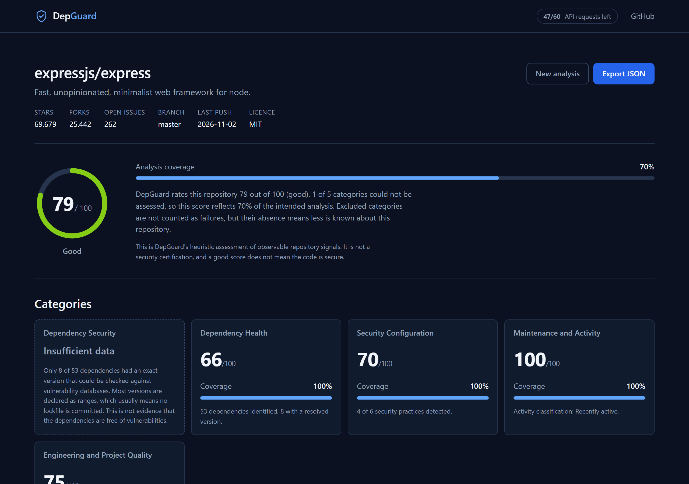
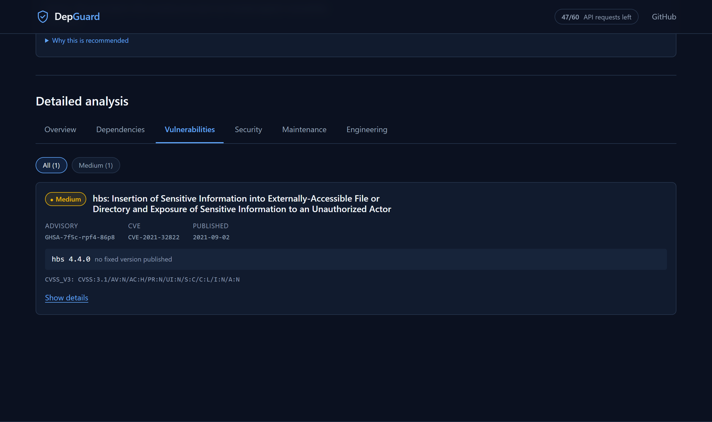
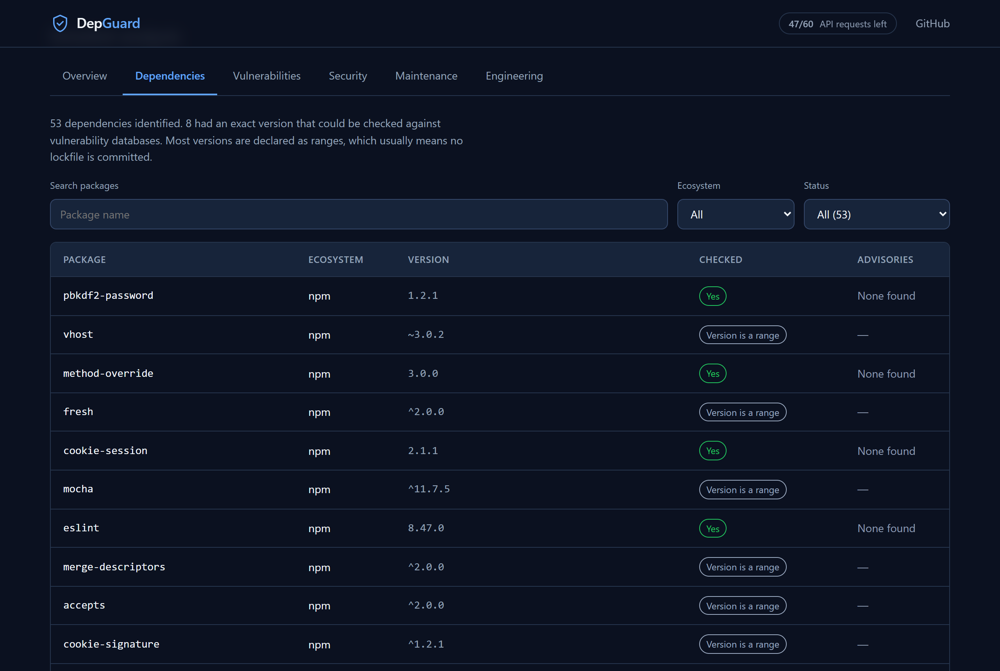

# DepGuard

**Know the health of any GitHub repository.**

[](https://github.com/dukeofwest/depguard/actions/workflows/ci.yml)
[](https://github.com/dukeofwest/depguard/actions/workflows/deploy.yml)
[](LICENSE)

DepGuard analyses a public GitHub repository and produces one evidence-backed report
covering its dependencies, security configuration, maintenance activity and engineering
signals. No account, no token, nothing stored — the analysis runs entirely in your
browser.

**Live:** https://dukeofwest.github.io/depguard/



---

## The problem

Deciding whether to depend on a repository means opening a dozen tabs: the commit history,
the releases page, the security tab, the dependency graph, whether there is a lockfile, a
licence, any tests. Each answers a fragment. None of them tells you how much you actually
managed to find out.

DepGuard consolidates those signals into one report — and, unusually, tells you how much
of the intended analysis it was able to complete.

## What makes it different

Most scanners present a clean result and a green badge. DepGuard is built around the cases
where it _cannot_ tell you something.

**A repository with no committed lockfile cannot report "no vulnerabilities found."**
GitHub reports dependency versions as the manifest declares them, so without a lockfile
they are ranges (`^1.2.1`) rather than resolved versions — and a range cannot be matched
against an advisory database. Measured across real repositories:

| Repository          | Dependencies checkable | Lockfile |
| ------------------- | ---------------------: | -------- |
| `npm/cli`           |                  84.9% | Yes      |
| `expressjs/express` |                  15.1% | No       |
| `request/request`   |                 **0%** | No       |

Where fewer than half can be checked, DepGuard reports **insufficient data** and says
plainly that this is _not evidence the dependencies are safe_. It also recommends the fix:
commit a lockfile.



**Every score carries its coverage.** A score of 92 at 70% coverage is a different claim
from 92 at 100%, and the interface never lets the two look alike.

**"Unknown" is never "fine".** A check that could not be performed is excluded from
scoring and reduces coverage — it is neither a zero nor a pass. The types enforce this: a
category that could not be assessed has no `score` field at all.

## The five categories

| Category                     | What it examines                                                                        |
| ---------------------------- | --------------------------------------------------------------------------------------- |
| **Dependency Security**      | Known advisories affecting resolved dependency versions, via OSV.dev                    |
| **Dependency Health**        | Inventory size, ecosystems, and how much carries usable version metadata                |
| **Security Configuration**   | Security policy, Dependabot config, CodeQL and dependency review workflows, CI, licence |
| **Maintenance and Activity** | Commit and release recency, contributors, archived status                               |
| **Engineering Quality**      | Documentation, test configuration, CI/CD, project metadata                              |

The dependency inventory distinguishes _checked and clean_ from _never checked_, and both
are filterable:



DepGuard is **not** a replacement for Dependabot, CodeQL, Snyk, Socket, OSV-Scanner or
Trivy. It does not read or execute source code, so it cannot find vulnerabilities in the
repository's own code — only in what it declares.

## How it works

```
URL ──► validated in-browser ──► GitHub REST (8 requests)
                                      │
                                      ├─► repository metadata, file tree, workflows,
                                      │   releases, contributors, languages, activity
                                      └─► dependency graph SBOM (SPDX 2.3)
                                              │
                                   pure TypeScript engine
                                   parse · classify versions · triage
                                              │
                                      OSV.dev (batched)
                                              │
                                   dedupe on CVE · read severity
                                   score · cover · recommend
```

Everything happens in the browser. There is no backend, and no proxy — a conclusion
reached by testing, not preference. The GitHub SBOM endpoint turned out to respond
synchronously with permissive CORS, verified in real headless Chrome from the production
origin with a negative control proving CORS was genuinely being enforced. See the
[browser CORS proof](docs/phase-0/BROWSER-CORS-PROOF.md).

## Privacy

Analysis runs entirely in your browser. DepGuard contacts exactly three hosts —
`api.github.com`, `raw.githubusercontent.com` and `api.osv.dev` — and never follows a URL
found inside repository content.

Nothing is stored: no `localStorage`, no cookies, no analytics, no telemetry. There are no
accounts and no tokens, so there is no credential to leak. Results live in memory for the
session and are gone on reload.

Full detail in [docs/PRIVACY.md](docs/PRIVACY.md).

### Rate limits

Anonymous GitHub access allows **60 requests per hour per IP address**. An analysis costs
8, so roughly 7 scans per hour. The remaining budget is shown in the header at all times,
and a scan will not start when too few remain — so it cannot fail halfway through.

## Technology

Angular 21 (standalone, zoneless, signals) · strict TypeScript · native CSS with design
tokens · Vitest.

No Nx, no NgModules, no UI component framework. Runtime dependencies are Angular, RxJS and
tslib — nothing else. No semver library (ranges are rejected, not resolved), no YAML
parser, and no Web Worker: the largest real SBOM (1.1 MB, 1,208 packages) parses in
**2.8 ms** on the main thread.

The analysis logic lives in [`src/app/engine/`](src/app/engine/) as pure TypeScript with no
Angular, DOM, I/O or clock access, so identical input always produces an identical report.
That boundary is enforced by **both** an ESLint rule and a unit test — it has caught three
real violations that review missed.

## Documentation

| Document                                      | Contents                                                   |
| --------------------------------------------- | ---------------------------------------------------------- |
| [ARCHITECTURE.md](docs/ARCHITECTURE.md)       | Layers, the engine boundary, state and cancellation        |
| [SCORING.md](docs/SCORING.md)                 | Weights, coverage floors, deductions, worked examples      |
| [DATA-SOURCES.md](docs/DATA-SOURCES.md)       | Every endpoint, why it is needed, and its quota cost       |
| [API-LIMITATIONS.md](docs/API-LIMITATIONS.md) | What DepGuard cannot determine, and why                    |
| [PRIVACY.md](docs/PRIVACY.md)                 | What is sent, to whom, and what is stored                  |
| [SECURITY.md](docs/SECURITY.md)               | Threat model, review findings, accepted risks              |
| [ROADMAP.md](docs/ROADMAP.md)                 | Open questions and what is deliberately deferred           |
| [adr/](docs/adr/)                             | Eight architecture decision records                        |
| [phase-0/](docs/phase-0/)                     | The feasibility report, with reproducible evidence scripts |

The Phase 0 report is worth reading if you want to know why the product works the way it
does: every significant decision was made against measurements from live APIs, including
one that disproved the specification's own premise.

## Local development

Requires Node 20.19+, 22.12+ or 24+.

```bash
npm install
npm start            # http://localhost:4200
```

On Windows PowerShell, use `npm.cmd` if the execution policy blocks `npm.ps1`.

### Verification

```bash
npm run lint         # ESLint, including engine purity rules
npm run typecheck    # strict tsc, including noUncheckedIndexedAccess
npm run test:ci      # 224 tests
npm run format:check
```

Opt-in live tests against the real APIs, which spend the hourly quota:

```bash
DEPGUARD_LIVE=1 npm run test:ci
```

### Build

```bash
npm run build                                  # production
npm run build -- --configuration github-pages  # adds base href /depguard/
```

### Browser tools

Driven by headless Chrome via the DevTools Protocol:

```bash
node tools/a11y-test.mjs      dist/depguard/browser   # contrast, keyboard, semantics
node tools/smoke-test.mjs     dist/depguard/browser   # render check, console errors
node tools/workflow-test.mjs  dist/depguard/browser   # full journey (uses API quota)
node tools/screenshot.mjs     dist/depguard/browser docs/screenshots
```

The accessibility tool probes all 49 token/surface colour combinations through the real
cascade and exits non-zero on a regression. It found 11 WCAG AA failures in the original
palette.

## Deployment

Pushing to `main` builds and publishes to GitHub Pages via
[`deploy.yml`](.github/workflows/deploy.yml), which runs lint, typecheck and tests first.
The `github-pages` build configuration sets the base href to `/depguard/`.

Requires Pages to be enabled for the repository with **GitHub Actions** as the source.

## Contributing

See [CONTRIBUTING.md](CONTRIBUTING.md). The one rule that matters: a report must never
claim more than the evidence supports.

## Licence

MIT — see [LICENSE](LICENSE).
